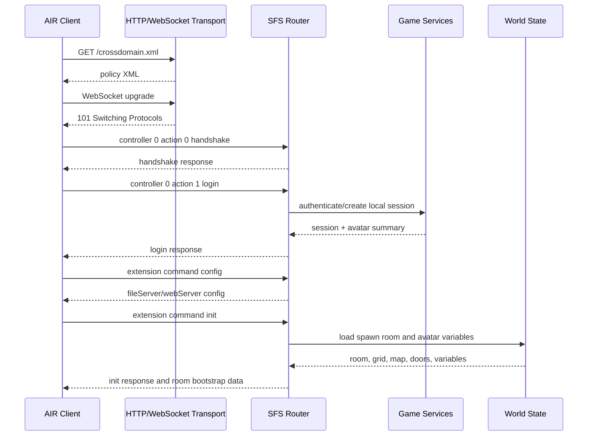

# Production SFS Server Architecture

This server will replace the temporary protocol probe with a production SmartFox-compatible game server for the recovered AIR client.

The probe remains in `server/probe` for now. Treat it as a protocol capture harness and executable reference, not as the production server foundation.

Status: draft only. Approve this architecture after the recovered client has been instrumented, run against the remote production server, and the captured room/command/event contracts have been reconciled with this design.

## Goals

- Speak the recovered client's SmartFoxServer 2X binary protocol over WebSocket on the client-facing port.
- Preserve the existing bootstrap flow: handshake, login, `config`, `init`, catalogs, avatar state, and first-room entry.
- Own durable game state: accounts, avatars, clothes, inventory, rooms, room variables, movement, chat, friends, moderation, and economy.
- Keep CDN/static asset serving separate from realtime game state.
- Make captured protocol behavior testable with packet fixtures before broad gameplay work begins.

## Non-Goals

- Do not keep extending `server/probe` into production code.
- Do not copy recovered client source into `server/src`; recovered code is protocol reference only.
- Do not depend on the original remote Sanalika backend.
- Do not redesign room artwork placement that is already baked into room SWFs.

## Current Anchors

- `server/src` is the production server root and is currently empty.
- `server/probe` is a CommonJS Node probe that manually handles HTTP, WebSocket, SFS packets, and a growing set of extension command responses.
- `server/config/local.json` defines the local bind address, port, CDN root, and environment.
- Room wire formats are known for grid, map, and doors; public-room map entries and bot definitions still need server-side authoring.

## Recommended Runtime Shape

Use Node.js with TypeScript for the first production server. This fits the current probe, lets us port known SFS packet logic directly, and keeps iteration fast while the protocol is still being recovered.

Primary dependencies should stay boring:

- `ws` for WebSocket transport.
- Native `http` or a small HTTP framework only for health, policy, and admin endpoints.
- `zod` or equivalent schema validation for config and authored room/catalog data.
- A relational database later for durable state; JSON files are acceptable only for the first offline milestone.

## Top-Level Modules

```text
server/src/
  config/              runtime config loading and validation
  transport/           HTTP policy endpoint, WebSocket upgrade, frame/session lifecycle
  sfs/                 SFS2X packet codec, controller/action routing, packet fixtures
  protocol/            extension command contracts and response builders
  game/                domain services for auth, avatars, rooms, inventory, chat
  world/               authored room data, grids, maps, doors, bots, spawn rules
  persistence/         repositories and storage adapters
  observability/       structured logging, metrics, packet trace controls
  main.ts              composition root
```

Keep transport, SFS packet codec, and game behavior separate. The production server should parse packets once, route by controller/action/extension command, call a game service, then encode a response through the SFS layer.

## Connection Flow



## Protocol Boundary

The production server should model three inbound packet families first:

1. System controller packets: handshake, login, logout, ping, join room, user variables.
2. Extension controller packets: command string plus SFSObject payload.
3. Room/user events: movement, chat, item interactions, door transitions.

Each command handler should return one of these results:

- direct response to the requester,
- broadcast to users in a room,
- session mutation only,
- error response with a client-compatible payload.

The SFS codec should be covered by binary fixtures copied from probe logs or generated from known good probe responses.

## Domain Model

Start with these durable concepts even if persistence is initially file-backed:

- `Account`: login identity, auth provider, bans, moderation flags.
- `Avatar`: name, gender, roles, permissions, clothes, status, current room, position, direction.
- `Room`: key, group, capacity, owner, room variables, grid, map, doors, bots.
- `InventoryItem`: product id, instance id, clip, type, subtype, color, quantity, ownership state.
- `CatalogItem`: static sellable/usable item metadata.
- `Friendship`: buddy list and presence state.
- `ChatMessage`: room/private chat event after filtering and moderation checks.

Do not couple these objects to SFS field names. Keep SFS serialization in protocol mappers.

## Room State

Public rooms need authored server data that the recovered client does not contain:

- grid bytes: Base64 of big-endian `int32 width`, `int32 height`, then `int8` cells row-major;
- map XML: Base64 XML containing chairs, stuff, sounds, cinema, billboard, pool, farm, and other interactive entries;
- doors JSON: `[{ key, targetX, targetY, targetDir, property:{ cn, ... } }]`;
- bots: positions, definitions, scripts, and movement behavior;
- spawn rules: door key to avatar position and direction.

For `street01`, keep the proven room geometry anchors:

- `xOrigin = 200`
- `yOrigin = 590`
- `tileWidth = tileHeight = 18.07`

## Persistence Phases

Phase 0 can be file-backed because the immediate risk is protocol correctness, not multi-user scale.

1. In-memory sessions and JSON-authored world/catalog data.
2. SQLite or Postgres for accounts, avatars, inventory, and social state.
3. Postgres plus Redis only when multi-instance realtime coordination is needed.

Avoid putting packet-shaped blobs directly into durable tables. Store domain state, then map it to the recovered client protocol at the edge.

## Security and Operations

- Validate every decoded SFSObject before using it.
- Put length limits on packet payloads, chat text, avatar names, room keys, and JSON/XML authored data.
- Rate-limit login, extension commands, chat, movement, and room transitions.
- Never trust client-provided avatar id, role, room ownership, item ownership, money, or permission fields.
- Keep packet hex dumps behind an explicit debug flag because they may contain user data.
- Add health endpoints separately from the SFS WebSocket path.

## Milestones

### Milestone 1: Production Skeleton

- Create TypeScript project under `server` or `server/src`.
- Move SFS codec behavior from probe into tested production modules.
- Add config loading for host, port, CDN host, CDN port, and log level.
- Serve `/crossdomain.xml` and accept WebSocket upgrades.
- Pass handshake, login, `config`, `init`, and `ping` against the recovered client.

### Milestone 2: Bootstrap Parity

- Port catalog/profile/clothes/avatar-create responses from the probe into command handlers.
- Add packet fixture tests for every supported command.
- Load authored world data from validated JSON files.
- Enter `street01` with correct room variables, grid, map, doors, and spawn.

### Milestone 3: Room Runtime

- Track connected sessions per room.
- Broadcast avatar join/leave, user variables, movement, and chat.
- Implement door transitions using server-authored door properties.
- Add basic anti-spam and invalid-movement rejection.

### Milestone 4: Durable Player State

- Add account/avatar persistence.
- Persist clothing changes, inventory ownership, profile fields, friend list, and room location.
- Add admin/moderation flags and command authorization.

### Milestone 5: Production Hardening

- Add structured logs, metrics, and protocol trace sampling.
- Add load tests for WebSocket sessions and high-frequency movement/chat.
- Add graceful shutdown and session cleanup.
- Split realtime server, CDN/static server, and admin tooling into separately deployable processes if needed.

## Probe Retirement Rule

Keep `server/probe` until production passes the same bootstrap scenarios with packet fixtures and the recovered client. After that, freeze the probe or delete it in one cleanup change. Do not mix probe fallbacks into production handlers.